<div align="center">

# Legend Arrow

**A calm arrow puzzle for Android: clear the board, awaken a legendary creature.**

[](https://github.com/MariaAlejandraBoadaRodriguez/legend-arrow/actions/workflows/ci.yml)


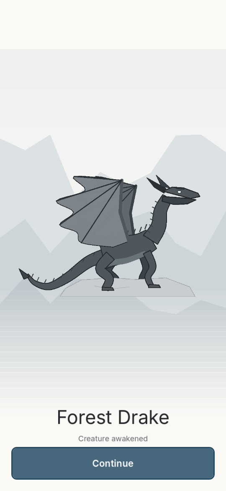

</div>

## 🎮 About the game

Legend Arrow is a calm puzzle game: every arrow on the board can slide out the way it points, but only if nothing stands in its path. Clear both puzzles of a creature and it **awakens** in a short animated sequence, then joins your **bestiary**. There are 12 legendary creatures across 3 realms to collect. It plays fully offline, with no account, no login and no email.

## 📸 Screenshots

All images are real captures of the running game (`tools/capture_screens.gd`, phone profile 540×1170). None are concept art.

<table>
  <tr>
    <td align="center">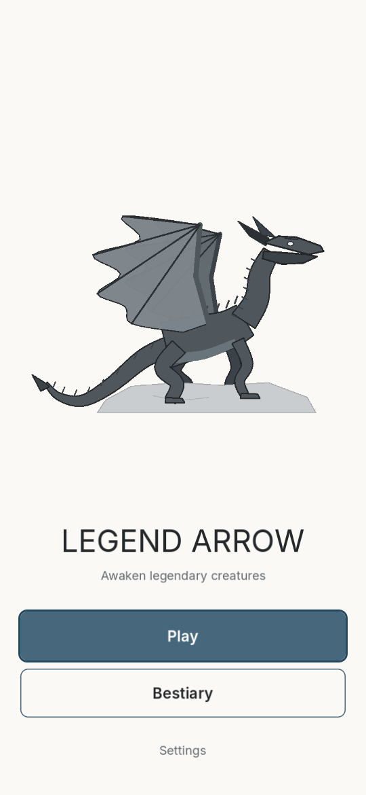<br><sub>Home</sub></td>
    <td align="center">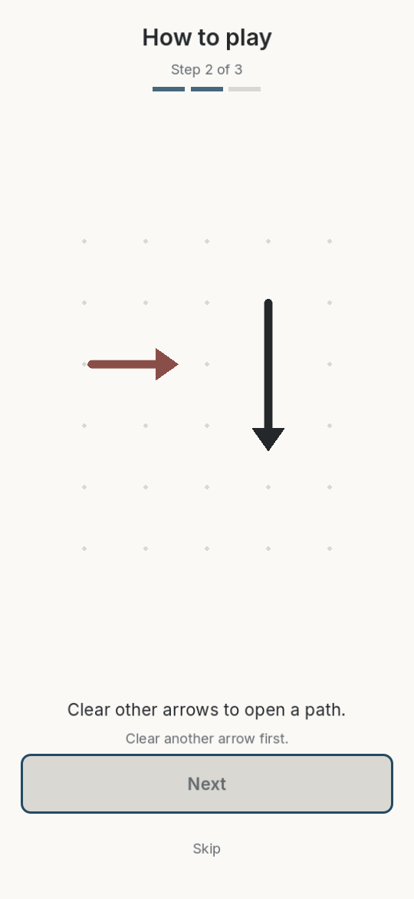<br><sub>Tutorial: a blocked arrow</sub></td>
    <td align="center">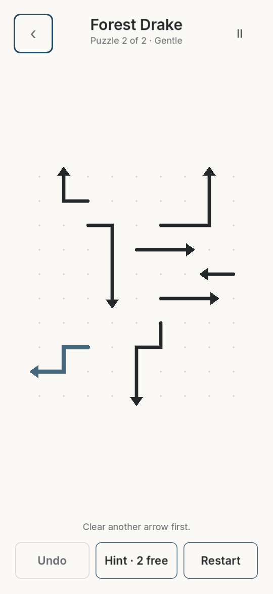<br><sub>Puzzle with a hint</sub></td>
  </tr>
  <tr>
    <td align="center">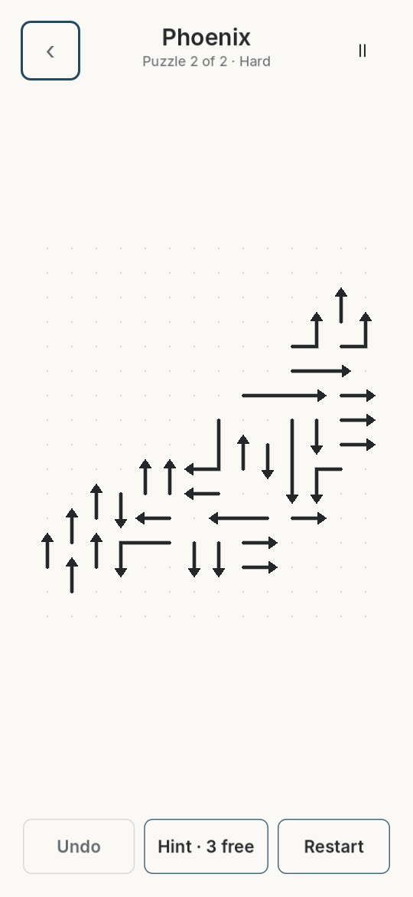<br><sub>Late game: Phoenix, 31 arrows</sub></td>
    <td align="center">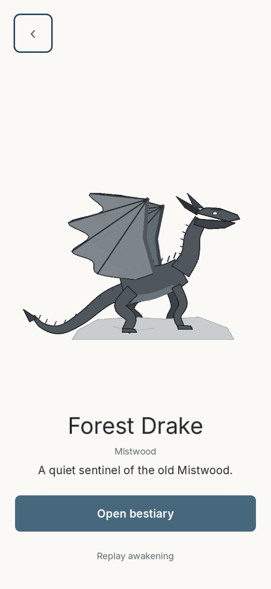<br><sub>Creature detail</sub></td>
    <td align="center">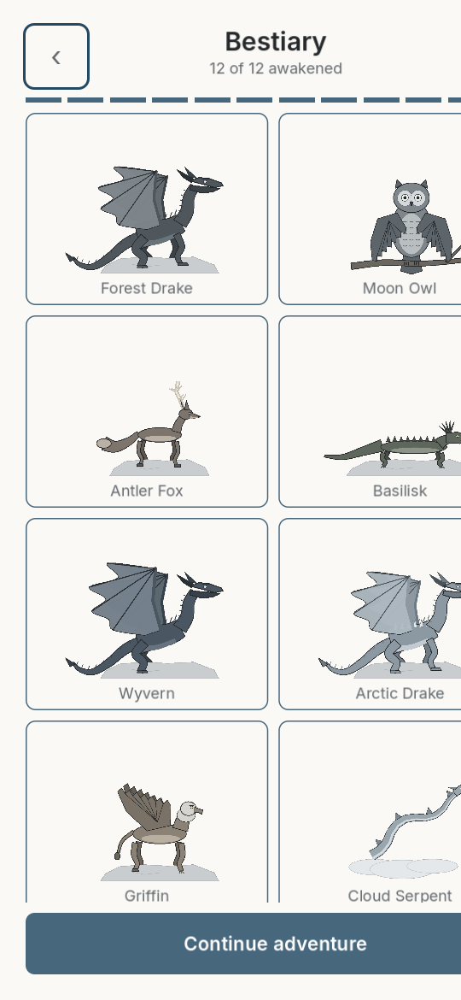<br><sub>Bestiary, 12 of 12 awakened</sub></td>
  </tr>
  <tr>
    <td align="center">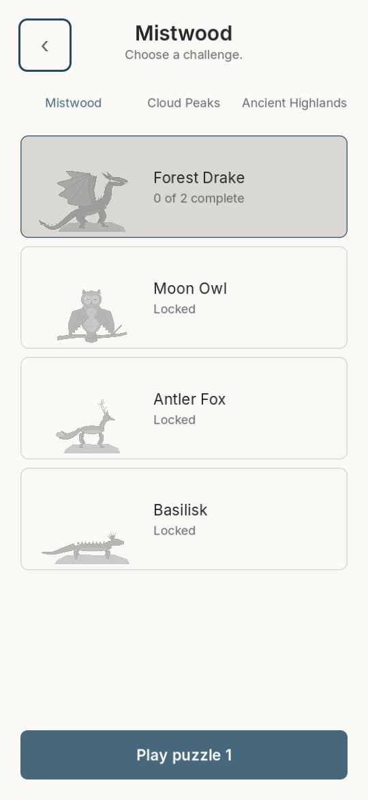<br><sub>Realms and level select</sub></td>
    <td align="center">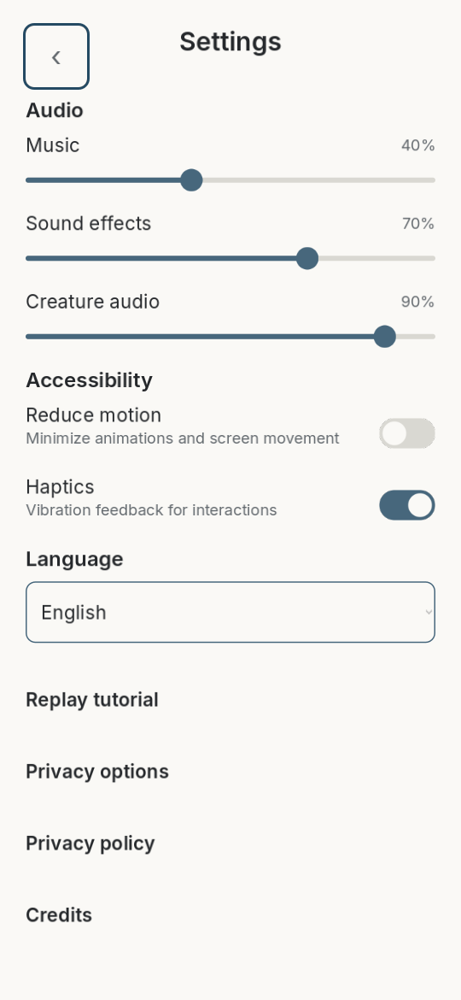<br><sub>Settings</sub></td>
    <td align="center">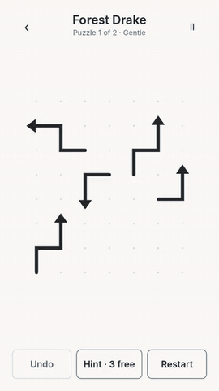<br><sub>Solving → awakening (GIF)</sub></td>
  </tr>
</table>

The GIF is cut from [`docs/media/legend_arrow_gameplay.mp4`](docs/media/legend_arrow_gameplay.mp4), a 25 s frame-by-frame recording of the real game (Godot Movie Maker, `scripts/record_video.sh`) while the automated *fresh install* journey plays.

## ✨ Features

**Gameplay**
- Swept-body arrow rules: an arrow leaves only if the path of **every** cell of its body is clear, so bent arrows can be blocked mid-body.
- Undo, restart, and 3 free hints per puzzle (a hint always points at a movable arrow).
- 24 generated and validated levels (5 to 36 arrows) for 12 creatures in 3 realms: Mistwood, Cloud Peaks and Ancient Highlands. Each board is shaped like its creature's silhouette.
- Pinch/wheel zoom and pan for the largest boards. Progress saves after every move.

**Bestiary and awakenings**
- 12 layered creature rigs, each with its own awakening (wings unfolding, a phoenix shedding embers, a wyrm rising from stone…).
- Original music and sound effects synthesised in code, with one motif per creature. No third-party audio.

**Languages:** English and Spanish, switchable in Settings.

**Accessibility**
- Reduced-motion setting: short fades instead of the full animations.
- Touch targets of at least 48 dp. Keyboard/D-pad focus navigation on the board.
- Text and UI colours are checked against WCAG AA contrast in unit tests. Haptics can be switched off.

**Privacy-first monetisation**
- One ad format only: a rewarded "watch ad for a hint", and only after the player chooses it. The whole game is completable without ads.
- Every player gets child/unknown-audience treatment: child-directed and under-age flags, G rating, no interstitials, and the advertising-ID permission removed.
- Google UMP consent; refusing consent never blocks play. No backend, accounts or analytics uploads.

## 🧩 How it works

Tapping an arrow slides the **whole** arrow towards its head until it leaves the board. It moves only if nothing is in the way of any of its cells.

```
     0 1 2 3 4
  0  . . . . .
  1  A A A > B      A wants to go right, but cell (3,1) holds B: blocked
  2  . . . . B
  3  . . . . v      B points down: its path is clear, so it leaves the board
                    ...and now A's path is clear too
```

The solver turns "A is blocked by B" into a dependency edge. A board is solvable exactly when that graph has no cycle, and removing an arrow can never block another, so a valid board can't deadlock:

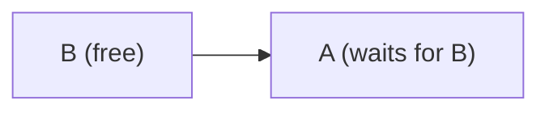

## 🏗️ Architecture

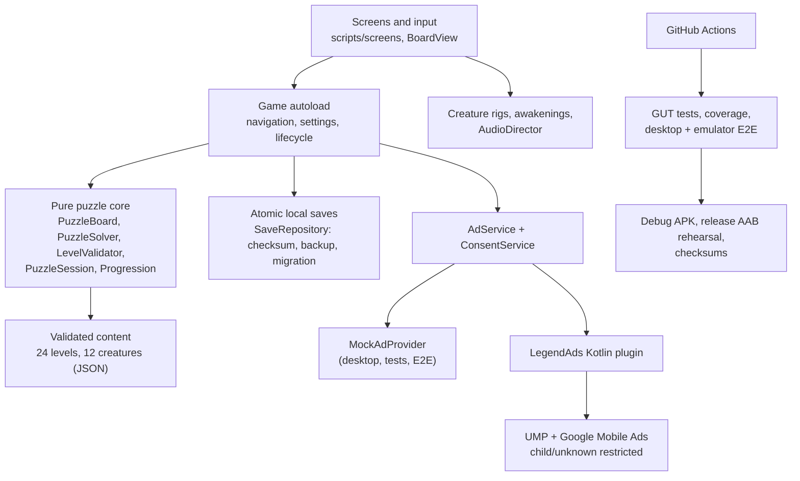

```
scripts/core/        pure rules: arrows, board, solver, validator, generator, saves
scripts/app/         Game autoload, main scene, AudioDirector, EventLog
scripts/screens/     one script per screen (home, puzzle, awakening, bestiary, …)
scripts/creatures/   CreatureRig + drake / quadruped / serpent skeletons, 12 creatures
scripts/services/    AdService, ConsentService, AdConfig, providers
scripts/e2e/         DeviceE2E: user journeys inside the real app (debug only)
android/plugins/     LegendAds Kotlin plugin (UMP + Google Mobile Ads) + JUnit
data/                campaign.json, levels/ (24), creatures/ (12)
tests/               unit, property, content, integration (GUT)
tools/               level/content/audio generators, coverage, screenshot capture
```

More detail: [docs/ARCHITECTURE.md](docs/ARCHITECTURE.md).

## 🛠️ Tech stack

| Area | Technology (pinned) |
|---|---|
| Engine | Godot **4.7.2-stable**, GDScript, Compatibility (OpenGL ES 3) renderer |
| Tests | GUT **9.7.1** (vendored), own JUnit gate and line-coverage tool |
| Android | minSdk **24**, compile/target SDK **36**, JDK **17**, Gradle **8.11.1**, AGP **8.6.1**, Kotlin **2.1.21** |
| Ads and consent | Google Mobile Ads **24.4.0**, User Messaging Platform **3.2.0** |
| Release tooling | bundletool **1.18.1** (checksum-pinned), 16 KB page-size check |
| CI | GitHub Actions (SHA-pinned actions), Android emulator API 34 |
| Typeface | Inter **4.1** (SIL OFL) |

Exact versions and commands: [BUILDING.md](BUILDING.md).

## ✅ Quality and testing

| What | Result |
|---|---|
| Automated tests (unit, property, content, integration) | **192 passing**, 0 failed, pending or assertion-free; an empty test run fails the build |
| Generated boards | **1,000 seeded boards** validated and solved, plus 300 random boards checked against a brute-force solver |
| Line coverage (own instrumenter, `tools/coverage.py`) | **94.8%** puzzle/solver/progression (target 90%), **95.1%** save/reward (target 80%) |
| Kotlin ads plugin | 15 core JUnit tests, Android lint clean |
| End-to-end journeys | 6 user journeys (8 runs, including kill and relaunch) pass on desktop at phone and tablet size **and** in the real APK on an Android 14 emulator |
| First launch with the real ads SDKs | App stays up on a cleared install with UMP + Google Mobile Ads (Google test IDs) |
| Release bundle | Validated with bundletool; download **30.7 MB** on arm64 (budget 120 MB) |

CI runs 6 jobs on every push and PR: Godot tests + coverage, Kotlin plugin, desktop E2E (phone and tablet), APK export + AAB rehearsal, and the emulator E2E. The latest `main` run is [#40589358249](https://github.com/MariaAlejandraBoadaRodriguez/legend-arrow/actions/runs/40589358249). The release-candidate runs were [push](https://github.com/MariaAlejandraBoadaRodriguez/legend-arrow/actions/runs/40580454945) and [PR](https://github.com/MariaAlejandraBoadaRodriguez/legend-arrow/actions/runs/40580462900).

Full evidence: [QA_REPORT.md](QA_REPORT.md) · [requirements → tests matrix](docs/REQUIREMENTS_MATRIX.md).

> **Known limitations:** performance on a physical phone hasn't been measured yet (`scripts/measure_device.sh` is ready). The emulator uses software rendering, so its frame rate isn't representative. The creature art is stylised procedural vector art, not final illustration.

## 🚀 Getting started

**Try the APK**
1. Open the latest green [CI run](https://github.com/MariaAlejandraBoadaRodriguez/legend-arrow/actions/workflows/ci.yml) and download the `legend-arrow-debug-apk` artifact. It's debug-signed and uses Google test ad IDs. No store release has been published yet.
2. In Android Studio, start an emulator (API 24 or newer) and drag the APK onto it, or run `adb install legend-arrow-debug.apk`.

**Build from source**
```bash
git clone https://github.com/MariaAlejandraBoadaRodriguez/legend-arrow.git
cd legend-arrow
scripts/verify_all.sh            # downloads pinned Godot, imports, compiles, runs all tests
scripts/desktop_e2e.sh           # the user journeys in the real game (Linux + Xvfb)
scripts/build_ads_plugin.sh && scripts/export_android.sh   # debug APK (needs Android SDK + JDK 17)
```
Or open `project.godot` in Godot 4.7.2 and press Play. See [BUILDING.md](BUILDING.md) for details.

## 🗺️ Roadmap

- [ ] Google Play release: internal → closed → staged production ([release procedure](docs/RELEASE.md))
- [ ] Real-device profiling on a low-tier phone (`scripts/measure_device.sh`)
- [ ] Daily challenge mode
- [ ] Art pass on the creature illustrations

## 👩‍💻 Author

**Designed and developed by María Alejandra Boada Rodríguez, software engineer.**
LinkedIn: _[add your LinkedIn URL here]_

Built with an AI-assisted autonomous workflow (Claude Code) under my product direction and specifications: I set the product vision, game design spec, visual direction, milestones and acceptance criteria, and reviewed the evidence from each milestone.

## 📄 License

© 2026 María Alejandra Boada Rodríguez. All rights reserved. No open-source license has been granted.
Third-party components and their licenses (Godot, GUT, Inter, Google SDKs): [docs/THIRD_PARTY_NOTICES.md](docs/THIRD_PARTY_NOTICES.md).
