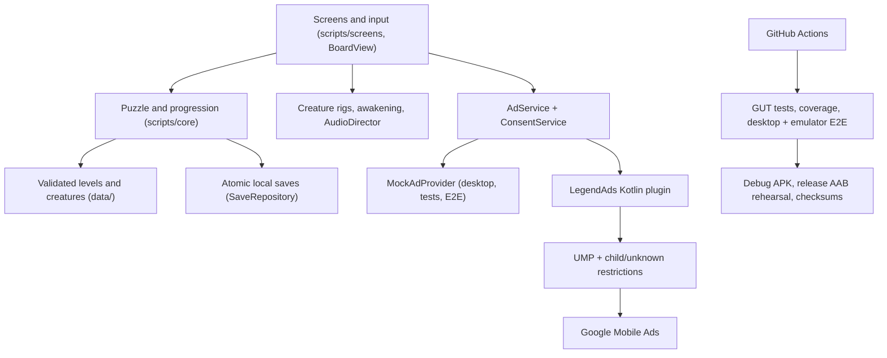

# Legend Arrow

A calm arrow-puzzle game for Android: clear arrows with an open path out, awaken legendary creatures, and collect them in a bestiary.

Built with Godot 4.7.2 (GDScript, Compatibility renderer) · Android · GitHub Actions. No accounts, no backend; plays offline.

## Status
Feature-complete v1 candidate: 12 creatures in 3 realms, 24 validated puzzles, tutorial, awakenings, bestiary, settings, EN/ES, original audio, optional rewarded hints (child-safe ad settings), atomic saves. CI runs unit/property/content/integration tests, coverage, desktop E2E, Android emulator E2E, debug APK and a release-AAB rehearsal. Release still needs owner inputs (upload key, AdMob IDs, Play Console) — see `docs/RELEASE.md`. Live state: `docs/PROGRESS.md`; test evidence: `QA_REPORT.md`.

## Play
Open the project in Godot 4.7.2 and press Play, or install the debug APK (`scripts/export_android.sh`, or the CI artifact `legend-arrow-debug-apk`) on an Android emulator.
Tap an arrow whose whole path to the edge is clear. Undo, Restart and three hints per puzzle are free. Clear both puzzles of a creature to awaken it.

## Quick start
```bash
scripts/verify_all.sh                 # import + script check + all GUT tests (downloads pinned Godot)
scripts/desktop_e2e.sh                # the 6 user journeys in the real game (needs Xvfb)
python3 tools/coverage.py             # line coverage vs the brief's targets
scripts/export_android.sh             # debug APK (Android SDK + JDK 17; see BUILDING.md)
scripts/android_e2e.sh <apk>          # journeys on a running emulator/phone (adb)
scripts/measure_device.sh <apk>       # startup / memory / frame-time report on a phone
scripts/export_release.sh [--rehearsal]   # release AAB (+ bundletool validation)
```
Open `project.godot` in Godot 4.7.2 to run the game. Details: `BUILDING.md`.

## Rules in one paragraph
Each arrow is a path on a grid; its head shows where it moves. Tapping an arrow slides the **whole** arrow that way until it leaves the board — only if nothing else is in the way of any part of it. Clear every arrow to awaken the creature.

## Layout
```
project.godot        Godot project (Legend Arrow)
scripts/core/        Pure logic: ArrowPath, PuzzleBoard, PuzzleSolver, LevelValidator,
                     LevelGenerator, PuzzleSession, LevelData, Campaign, Progression,
                     SaveSchema, SaveRepository
scripts/app/         Game autoload (navigation, settings, lifecycle), main scene, EventLog
scripts/ui/          Theme, palette, BoardView, dialogs, widgets
scripts/screens/     One script per screen (scenes/screens/*.tscn)
scripts/creatures/   CreatureRig, shared skeletons (drake, quadruped, serpent), 12 creatures
scripts/services/    AdService, ConsentService, AdConfig, InterstitialPolicy, mock + Android providers
scripts/e2e/         DeviceE2E: user journeys inside the real app (debug builds only)
data/                campaign.json, tutorial.json, levels/ (24), creatures/ (12)
locales/strings.csv  English + Spanish UI strings
assets/              Inter font, launcher icons, synthesised audio
scripts/*.sh|.py     verify_all, desktop/android E2E, export (APK/AAB), checks, measure_device
android/plugins/     LegendAds Kotlin plugin (UMP + Google Mobile Ads) with JUnit tests
addons/legend_ads/   Export plugin: AAR, dependencies, manifest (removes AD_ID)
tests/unit/          Rule, solver, validator, session, RNG tests (GUT)
tests/property/      1,000 seeded generated boards + solver-vs-brute-force
tests/content/       Packaged levels, tutorial and campaign validation
tests/integration/   Real screens driven in-engine (journeys, input, leaks)
tools/               Level/content/audio generators, coverage, compile check, renders
addons/gut/          Vendored GUT 9.7.1 (tests only)
docs/                Brief, spec, mockups, roadmap, decisions, progress
```

## Architecture

Details: `docs/ARCHITECTURE.md`.

## Documentation
`BUILDING.md` · `QA_REPORT.md` · `RELEASE_CHECKLIST.md` · `docs/RELEASE.md` · `docs/OPERATIONS.md` · `docs/ARCHITECTURE.md` · `docs/UI_FLOW.md` · `docs/LEVEL_FORMAT.md` · `docs/SAVE_FORMAT.md` · `docs/ART_AND_ANIMATION.md` · `docs/ADS_AND_PRIVACY.md` · `docs/PRIVACY_POLICY.md` (draft) · `docs/DATA_SAFETY.md` · `docs/REQUIREMENTS_MATRIX.md` · `docs/ROADMAP.md` · `docs/DECISIONS.md` · `docs/PROGRESS.md` · `docs/THIRD_PARTY_NOTICES.md` · screenshots in `docs/screenshots/` and CI artifacts
