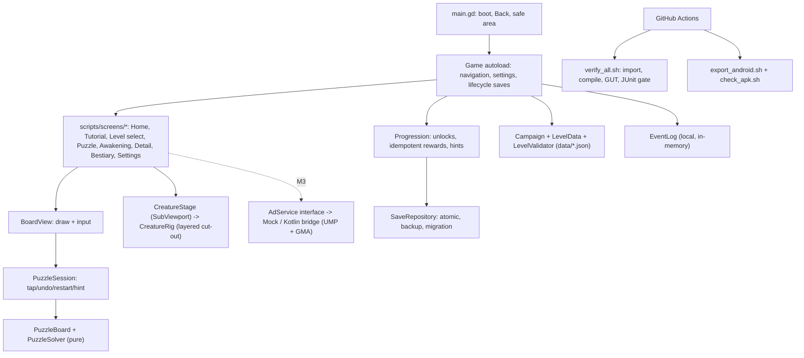

# Architecture

- `scripts/core/` is pure (RefCounted, no nodes): runs headless, unit/property tested.
- Screens never mutate the model directly: BoardView emits `arrow_tapped`; the screen calls `session.tap()`, persists, then animates.
- Rewards: completion and unlock are transactions keyed `complete:<level>` / `unlock:<creature>` — replay, skip, kill and relaunch cannot duplicate them.
- Ad callbacks (M3) will go through Progression.grant_ad_hint(presentation_id) — idempotent and node-free.
- No backend; no network on any game path.
