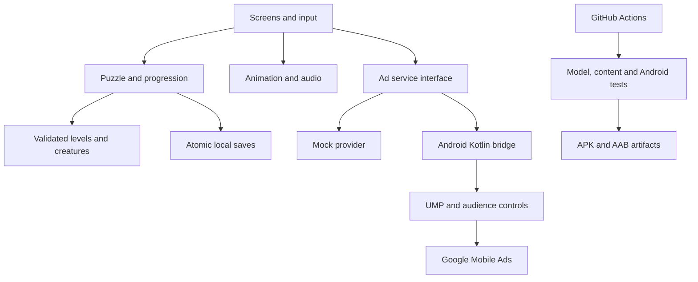

# Legend Arrow — Build, Test and Deliver the Android Game

Act as a senior Android game developer and technical lead with experience taking mobile games from concept to production. Cover game design, UX/UI, architecture, graphics, animation, sound, Android integrations, automated testing, GitHub Actions and release engineering.

Make pragmatic decisions that balance quality, delivery speed, operating costs and device performance.

Using the attached specification and mockups, refine and execute the complete development plan for **Legend Arrow**, from reviewing the design to delivering a functional, tested Android application and preparing its production release.

**Do not stop after presenting a roadmap. Execute it.**

## 1. Project context

### Concept

Legend Arrow is a calm arrow puzzle game for Android.

Players remove arrows from a board by choosing paths with an unobstructed exit. The arrows form silhouettes of dragons and other fantastic creatures. Completing the required puzzles awakens each creature through an impressive animation and adds it to a collectible bestiary.

The rules must be understandable to a ten-year-old, while the art direction, writing and challenge remain appealing to adults.

### Required MVP features

1. Interactive tutorial and playable arrow puzzles with validated solutions, hints, undo and restart.
2. A campaign containing 24 levels and 12 collectible creatures, following the attached specification.
3. Distinct creature awakening animations, replayable creature details and a bestiary.
4. Immediate guest play, offline campaign access, automatic local saves, English/Spanish localization and accessibility settings.
5. Advertising monetization through optional rewarded hints and carefully limited interstitials, subject to consent and audience requirements.

### Preferred stack

Use the attached specification as the technical baseline:

- Stable Godot 4.x with GDScript.
- Compatibility renderer for broad Android support.
- Android Studio, Android SDK and a compatible JDK/Gradle toolchain.
- Kotlin Android bridge when needed for Google Mobile Ads and UMP.
- Local versioned JSON content and atomic local save files.
- GitHub repository and GitHub Actions for automated validation and build artifacts.

Verify current compatibility against official documentation and pin exact versions.

Do not introduce a web frontend, database server, backend API or cloud infrastructure unless a concrete requirement makes it necessary. Explain any proposed departure from the baseline before implementing it, but resolve ordinary technical decisions autonomously.

### Team

One product owner, supported by you as the autonomous development agent.

Do not assume other developers, paid contractors, paid assets or additional paid services are available.

### Time and resources

Use a provisional planning window of **15–25 working days**, to be revised after repository inspection and the first Android vertical slice.

This is a planning assumption, not a guaranteed delivery date.

The owner has Claude Pro. Do not assume unlimited usage, API credits, continuous unattended execution or extra paid tools.

Reduce unnecessary context consumption through concise documentation, targeted file reads, small implementation batches and durable progress checkpoints. Do not reduce testing, correctness or agreed functionality to save tokens.

### Constraints

- No email, password, account or mandatory social login.
- Campaign and collection work without internet.
- Ads never block campaign completion or creature collection.
- White/ivory backgrounds, graphite typography and restrained slate-blue accents.
- Mature fantasy creatures; no childish writing or excessively colorful interfaces.
- No mandatory backend or recurring hosting expense.
- Accessible contrast, readable text, usable touch targets and reduced-motion support.
- Respect Android lifecycle, safe areas and low/mid-tier device limitations.
- No embedded credentials or release signing secrets.
- Advertising and data handling must reflect the intended mixed-age audience.

### Key risks

- **Scope:** unnecessary systems, decorative complexity and unfinished content.
- **Technical:** puzzle solvability, unclear input, animation quality, memory, Android compatibility, saves and advertising callbacks.
- **Delivery:** reproducible builds, GitHub permissions, CI failures, signing, store requirements and external configuration.
- **Product:** intrusive advertising, confusing onboarding and poor replay motivation.

## 2. Source of truth

Read:

1. The attached Android development specification.
2. `READ_FIRST_CLAUDE.md`.
3. All individual mockups.

Use **Legend Arrow** as the final product name throughout the application and documentation.

The written specification governs gameplay, security, privacy and testing. The approved white-background mockups govern visual direction.

Generated images are design references, not executable UI, certified solvable boards or ready-to-use animation rigs.

Resolve discrepancies using these priorities. Record assumptions and trade-offs in `docs/DECISIONS.md`.

## 3. Required roadmap structure

Before implementation, produce a concise actionable roadmap.

For every phase include:

- **Activity:** the precise work.
- **Tools:** technologies and services.
- **Risk addressed:** scope, technical or delivery.
- **Justification and trade-off:** why this approach is appropriate.
- **Deliverable:** the concrete artifact.
- **Definition of Done:** measurable completion criteria.
- **Dependencies and estimated working days.**

Cover every phase below. Then implement the roadmap.

### Phase 1 — Requirements and repository audit

Inspect the available repository, files, installed tools and authentication state. Preserve unrelated work.

Translate requirements into acceptance criteria and identify genuine external dependencies.

**Done when:** requirements, assumptions, scope boundaries and acceptance criteria are documented with no unresolved routine engineering decisions.

### Phase 2 — Mockups, wireframes and interaction flow

Review every supplied screen. Improve usability where necessary while preserving the approved aesthetic.

Define all transitions, empty states, loading states, blocked moves, ad failures and recovery behavior.

**Done when:** every required screen and interaction has a documented state and navigation destination.

### Phase 3 — UI and design system

Implement reusable colors, typography, spacing, buttons, dialogs, collection cards, safe-area handling and accessible focus states.

**Done when:** representative phone and tablet screenshots show no clipping, unreadable controls or departure from the restrained palette.

### Phase 4 — Architecture and data model

Separate puzzle rules from rendering, input, saves, progression, ads and platform services.

Document level schemas, creature metadata, save versions and reward transaction handling.

**Done when:** the pure game model runs headlessly and data contracts have validation tests.

### Phase 5 — Backend/API assessment

Explicitly assess whether a backend is needed.

For this MVP, prefer local content and local saves. Document this phase as “No backend required” if the requirements remain satisfied.

Implement service interfaces for ads, consent and optional future configuration without building unnecessary infrastructure.

**Done when:** the game has no hidden dependency on a server and service boundaries are documented.

### Phase 6 — Game client and content

Implement the tutorial, campaign, board interactions, hints, undo, restart, progression, bestiary and settings.

Complete all 24 levels, all 12 creatures, final usable artwork, sound and distinct awakening animations.

**Done when:** the full campaign can be completed offline and every creature unlocks correctly.

### Phase 7 — Android and monetization integration

Integrate Android export, lifecycle handling, audio focus, local persistence, consent and test advertising.

**Done when:** an installed Android build preserves progress through interruptions and handles successful, failed, unavailable and dismissed ads without reward duplication.

### Phase 8 — Automated testing and repair

Execute unit, integration, content validation and end-to-end tests.

Repair failures autonomously, add appropriate regression tests and rerun verification.

**Done when:** the required tests pass on the final source revision and their evidence is available.

### Phase 9 — GitHub, CI/CD and release preparation

Upload the complete source project to GitHub and execute the game tests through GitHub Actions.

Produce installable build artifacts and prepare the production release configuration.

**Done when:** the final commit has a successful required CI run, downloadable artifacts and a documented release procedure. External publication prerequisites must be explicitly reported if unavailable.

### Phase 10 — Monitoring and post-launch readiness

Prepare minimal diagnostics, crash investigation, content update procedures and rollback instructions.

Keep external telemetry disabled unless its audience and privacy configuration is appropriate.

**Done when:** the handoff explains how to diagnose failures, reproduce builds, restore save compatibility and issue a corrective release.

## 4. Game-specific testing requirements

Test the actual game, not only formatting and compilation.

### Unit tests

Cover:

- Arrow exits in all four directions.
- Full swept-body collision checks, including a clear arrowhead with a blocked body.
- Blocked moves leaving state unchanged.
- Undo and restart correctness.
- Level completion and two-puzzle creature unlocks.
- Save serialization, migration and corrupt-file recovery.
- Idempotent completion and reward transactions.
- Hint selection and ad frequency boundaries.

### Content and solver tests

- Validate all 24 packaged levels.
- Execute every recorded solution.
- Reject invalid, overlapping or malformed paths.
- Check 1,000 deterministic generated test boards.
- Verify removal monotonicity and the absence of deadlocks under the removal-only rules.

### Integration tests

Cover:

- Puzzle → save → reload.
- Completion → progression → awakening → bestiary.
- Ad earned-reward callbacks, duplicate callbacks, dismissal and failure.
- Consent refusal, restricted audience handling and offline play.
- Background/resume and interrupted animations.
- Sound preferences and reduced-motion settings.

### End-to-end tests

Automate:

1. Fresh installation → tutorial → first completed creature.
2. Partial puzzle → app termination → relaunch → restored progress.
3. Blocked move → undo/restart → successful completion.
4. Rewarded hint success and ad-unavailable fallback.
5. Creature awakening → skip/replay → bestiary.
6. Language/settings changes → restart → persisted preferences.

Use real scene interaction and Android instrumentation where feasible. A pure-model test must not be mislabeled as a UI end-to-end test.

### Coverage targets

- At least **90% executable-line coverage for pure puzzle, solver and progression logic**.
- At least **80% for save and reward-handling logic**, where supported by the selected tools.
- Automated coverage of every critical user journey listed above.

Use a compatible coverage tool and publish the report. If reliable GDScript line coverage is unavailable, explicitly report that limitation and provide a requirements-to-tests matrix; do not invent coverage percentages or claim the numerical target was met.

Physical-device performance and visual animation quality require separate evidence. Emulator success alone is insufficient.

## 5. GitHub requirements

Use available authenticated GitHub access.

- If an appropriate repository already exists, use it.
- Otherwise, create a **private repository named `legend-arrow`**, if permissions allow.
- Do not change repository visibility or overwrite unrelated history.
- Never commit credentials, signing keys, tokens, local save data or generated dependency caches.
- Commit coherent implementation milestones and push them.
- Include a README with setup, build, play and test instructions.

If authentication or repository permissions are unavailable, complete local development and CI configuration, then report the exact external blocker. Do not request passwords or fabricate a repository URL.

### Required GitHub Actions checks

On pull requests, pushes to the main branch and manual dispatch:

1. Import the Godot project and detect script errors.
2. Run unit and integration tests.
3. Validate packaged levels and recorded solutions.
4. Run deterministic generation/property tests.
5. Run Kotlin tests and Android lint where applicable.
6. Export the Android debug APK.
7. Run the critical Android smoke/end-to-end suite on an emulator.
8. Upload test reports, logs, screenshots and build artifacts.

Use official test ad identifiers and mock providers in CI. Never request or click live ads during tests.

Pin action/dependency versions, use minimal workflow permissions and ensure test failures propagate as failed jobs. Empty test discovery must fail.

Create a separate scheduled/manual workflow for heavier device matrices and soak tests if runtime makes them unsuitable for every push.

After pushing, inspect the actual workflow results. Fix failed jobs and push corrections until required checks pass or a genuine external limitation prevents execution.

**Writing a workflow file does not prove that tests ran on GitHub.**

## 6. Autonomous execution and correction

Proceed without asking the owner to approve ordinary implementation choices or error fixes.

For each failure:

**Reproduce → diagnose → fix → run regression tests → rerun the required verification suite.**

Do not:

- Disable tests to obtain a green build.
- Weaken requirements without documenting the unmet requirement.
- Replace real animation with a static image and call it finished.
- Replace playable UI with full-screen mockup images.
- Claim production readiness while required checks remain unexecuted.
- Stop after presenting a plan when implementation remains possible.

Maintain `docs/PROGRESS.md` with completed work, current commands, remaining tasks and blockers so work can resume accurately if the session ends.

## 7. Production readiness checklist

Provide evidence for:

- Reproducible Android builds and pinned dependencies.
- Correct package identity, version code and version name.
- Current target API and native library compatibility.
- Production configuration separated from test configuration.
- No committed secrets; signing material stored appropriately.
- Ad consent and audience configuration.
- Privacy-policy and store Data Safety preparation.
- Atomic saves, recovery and migration tests.
- Sanitized logs and practical crash diagnosis.
- Performance and memory checks on named devices.
- All required CI jobs passing on the final commit.
- APK/AAB artifact checksums.
- Release notes and known limitations.
- Rollback/recovery procedure.

For Google Play, explain that returning to previous functionality normally requires a corrective release with a higher version code, plus compatible save migrations. Do not propose uploading an older version code.

Build and distribute test artifacts automatically. Submit a production release only when the necessary credentials, store declarations, signing and explicit publication authorization are available. Otherwise deliver a release-ready handoff and identify those external prerequisites precisely.

## 8. Final deliverables

Provide:

1. The phased roadmap with measurable Definitions of Done.
2. The complete functioning Godot/Android source project.
3. The actual GitHub repository URL, if successfully created or updated.
4. The final commit SHA.
5. Links to the actual GitHub Actions runs.
6. Test counts, coverage evidence and unresolved limitations.
7. An installable debug APK.
8. A validated AAB where the environment permits.
9. Screenshots and a captured gameplay/awakening video where capture is available.
10. Build, architecture, content, privacy, testing and release documentation.
11. Repository folder structure.
12. A Mermaid architecture diagram.

Use this architecture as a starting point, adjusting it only when justified:

Start now with repository inspection and a concise roadmap, then immediately proceed to implementation.

Finish only when all work executable in the available environment is complete, failures have been corrected, and the final report clearly distinguishes **PASS, FAIL, BLOCKED and NOT RUN**.